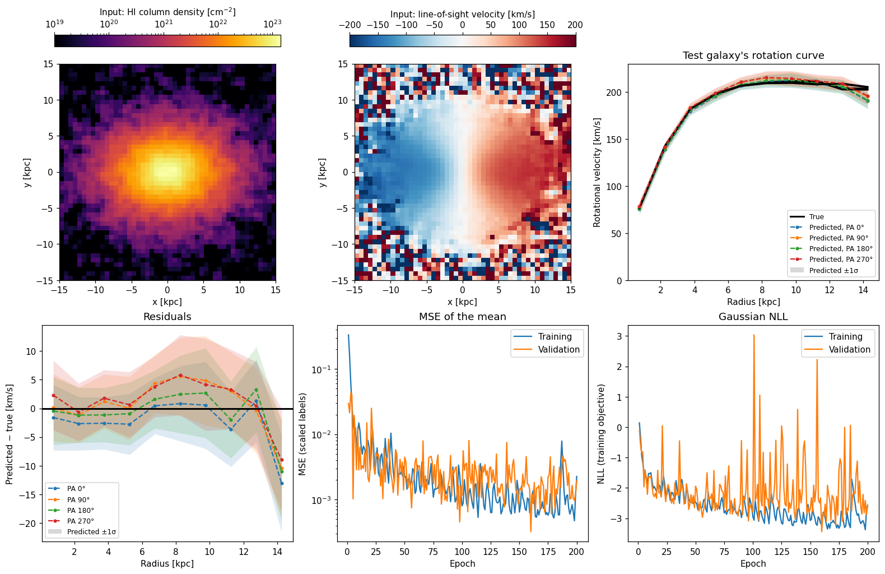

# CoNNGaFit

[](https://github.com/ctrapped/CoNNGaFit/actions/workflows/tests.yml)

**Co**nvolutional **N**eural **N**etworks for **Ga**laxy **Fit**ting: train 3-d convolutional neural networks to predict the physical properties of a galaxy's gas, such as its radial momentum or rotation, directly from HI 21cm spectral datacubes.

Training data comes from [VeryObservableFIRE](https://github.com/ctrapped/VeryObservableFIRE) (VOF), which turns FIRE galaxy simulations into synthetic telescope observations paired with the true gas properties at every pixel.

## Highlights

- **Networks:** a 3-d residual U-Net (`conngafit/models/unet3d_resblock.py`) that reads a whole spectral datacube and predicts a map (one value per pixel) or a radial curve, optionally with each value's 1σ. Three output heads are available: two fully convolutional heads for large images, and a fully connected head for small images and radial curves. A conditional diffusion model (DDPM, `conngafit/models/unet3d_ddpm.py`) instead samples maps from their posterior, giving each pixel's mean and standard deviation.
- **Targets:** mass, radial / cylindrical-radial / rotational velocity, and radial / cylindrical-radial / rotational momentum (mass × velocity), all read from VOF's per-pixel annotations.
- **Configuration:** hyperparameters and datasets live in two TOML files, so a training run is reproducible from its config, and every trained model stores both files alongside its weights.
- **Development:** 278 automated tests on synthetic data, including end-to-end training runs; continuous integration (GitHub Actions) runs them on Python 3.11 and 3.12, plus [ruff](https://docs.astral.sh/ruff/) linting and formatting.

## Installation

Requires Python 3.11+. From the repository root:

```bash
pip install -e .            # CoNNGaFit and its dependencies
pip install -e ".[dev]"     # + development tools (pytest, ruff, pre-commit)
```

To train on a GPU, install a CUDA-enabled build of PyTorch first (see [pytorch.org](https://pytorch.org/get-started/locally/)). Instructions for the Quartz cluster at IU are in [`docs/quartz`](docs/quartz/README.md).

The library code is the `conngafit` package (its networks are in `conngafit/models/`), and the command-line scripts for training, inference and converting FITS files are in `scripts/`. Installing the package makes it importable from the scripts, examples and tests, so run them from the repository root after installing.

## Demo

```bash
python examples/demo.py
```

Trains a small network on VOF observations of six synthetic disk galaxies, each rotating at a different speed ([`examples/demo_data`](examples/demo_data), ~10 MB), then predicts the rotation curve of a galaxy it hasn't seen, along with 1σ uncertainty. It needs no simulation data, takes a few minutes on a laptop CPU, and writes `examples/demo_output/demo.png`:



`python examples/demo.py --predict map` trains the network on the rotational velocity map instead, with each pixel's 1σ, and bins the predicted map into the rotation curve (mass-weighted, as the true curve is). Its figure, `demo_map.png`, adds the true, predicted and residual velocity maps and the predicted 1σ map. Pass its network to `demo_inference.py` with `--model-path examples/demo_output/NetworkWeights/demo_map`.

To run a trained network on new datacubes without training, run

```bash
python examples/demo_inference.py
```

which runs the pre-trained demo network in [`examples/demo_model`](examples/demo_model) on the test galaxy in a few seconds, writing a plot and an `.hdf5` file of each predicted rotation curve and its 1σ uncertainty to `examples/demo_output/inference/`. Pass `--model-path examples/demo_output/NetworkWeights/demo` to use the network you trained with `demo.py` instead.

[`examples/make_demo_data.py`](examples/make_demo_data.py) regenerates the data with VOF.

### Experiments

[`experiments/`](experiments) holds scripts that try newer features on the demo data, such as predicting several maps at once or sampling maps with the DDPM. They run like the demo but don't yet predict as well.

## Training

```bash
python scripts/train_model_unet.py --run-name my_run
```

Training is set by two parameter files, `configs/hyperparams_resblock.toml` and `configs/datasets.toml` by default; pass others with `--hyperparams` and `--datasets`. Every key is required unless marked optional.

The hyperparameters file's `network` key chooses the network, and so which other keys it needs:

| `network` | Starting points | Predicts |
|---|---|---|
| `"resblock"` | `configs/hyperparams_resblock.toml` (radial momentum), `configs/hyperparams_resblock_rc.toml` (rotational velocity) | maps or radial curves, with each value's 1σ if `predict_variance = true` |
| `"ddpm"` | `configs/hyperparams_ddpm.toml` | maps only (`radial_bins = 0`): the mean and standard deviation of `n_samples` posterior samples, drawn jointly for every target |

### Datasets file

`configs/datasets.toml` sets what to learn and which VOF outputs to learn it from:

```toml
target = "radial_momentum"      # mass, radial_velocity, cylindrical_radial_velocity, rotational_velocity,
                                # radial_momentum, cylindrical_radial_momentum, rotational_momentum;
                                # or a list, e.g. ["mass", "rotational_momentum"], to predict a map of each
augment = "major_axis"          # rotations/flips added to the training set: "major_axis", "all" or "none"
inclinations = [45]             # inclinations to use in every set: "all", or a list in degrees
radial_bins = 0                 # 0 trains on maps; N > 0 trains on N-bin radial curves
radial_projection = "face_on"   # where radial curves are measured: "face_on" or "sky"
suffix = ""                     # optional: VOF's outputSuffix in the filenames
base_dir = "/path/to/VOF_outputs"  # optional: relative paths below are relative to this

[training]
"m12i/vof_outputs" = [500, 600]   # a VOF output directory = a snapshot, or an inclusive [min, max] range
"m12f/vof_outputs" = 600

[validation]
"m12c/vof_outputs" = 600

[testing]
"m12m/vof_outputs" = 600
```

Each path is a VOF output directory, containing one folder per inclination (`i45/`, ...). CoNNGaFit loads every `*_fullSpectra.hdf5` image in it that matches the inclinations, snapshots and suffix.

### Hyperparameters file

| Network | Key | Meaning |
|---|---|---|
| Both | `network` | `"resblock"` or `"ddpm"` (see above) |
| | `learning_rate`, `weight_decay`, `epochs` | Adam optimizer settings and training length |
| | `n_filt0`, `k0`, `k1` | Filters in the first encoder stage (doubling at each later stage), stem kernel size, residual/deconv block kernel size |
| | `block_dropout_rate` | Channel-wise dropout inside every block (off by default) |
| | `label_scaling` | `"none"`, `"symmetric"` (divide by max \|label\|) or `"one-sided"` (map [min, max] to [-1, 1]). The DDPM clips its samples to [-1, 1] unless `"none"` |
| | `predict_every` | Predict the training and validation sets, and so score their accuracy and MSE, every `predict_every` epochs and on the final epoch; the loss is computed every epoch |
| | `seed` | Random seed for weight initialization, dropout, batch order and the diffusion noise; the same seed, data and settings on the same machine give the same network |
| ResBlock | `output_head` | `"conv_halfres"`, `"conv"` or `"fc"` (see the comments in the file) |
| | `n_fc` | Width of the fully connected head's hidden layers (`output_head = "fc"` only) |
| | `dropout_rate` | Dropout before the output layer |
| | `predict_variance` | `true` also predicts each value's 1σ uncertainty: the network outputs a mean and log-variance and trains with `nn.GaussianNLLLoss` instead of MSE. Needs `label_scaling = "symmetric"` or `"one-sided"` |
| | `mass_weight_power` (optional) | Weights each pixel's (or ring's) loss by mass to this power, normalized per image (0: unweighted, the default; 0.5 is a good start). Meant for velocity targets; pixels with no mass aren't trained, so their predictions and 1σ aren't meaningful |
| DDPM | `n_timesteps`, `schedule` | Diffusion steps, and the noise schedule: `"cosine"` or `"linear"` |
| | `n_samples` | Posterior samples per prediction. Each sample takes `n_timesteps` denoiser passes, so set `predict_every` to keep predictions during training affordable |

### Command-line options

| Option | Default | Purpose |
|---|---|---|
| `--run-name` | the targets, joined by `_` | Name of the checkpoint and every diagnostic output |
| `--network-dir` | `NetworkWeights` | Where the trained model is written |
| `--output-dir` | `DiagnosticOutputs` | Where diagnostic images and plots are written |
| `--batch-size` | ~1/10 of the training set (at least 2) | Training batch size; `0` trains on the full set as one batch |
| `--test-batch-size` | ~1/10 of the validation set | Validation/testing batch size |
| `-v` / `-q` | | Show debug messages / only warnings and errors |

Both output directories are created if missing. Run with `--help` for details.

### Outputs

```
NetworkWeights/
  <run-name>.pt       trained weights
  <run-name>.hdf5     everything needed to rebuild and use the network: image normalization
                      (image_stats), label scaling of each target (label_stats), the targets,
                      input_shape, every hyperparameter of its network, and the full text of
                      both parameter files
DiagnosticOutputs/
  images/             final-epoch prediction vs. truth for every target of every training,
                      validation and test sample (.hdf5, plus a comparison .png for validation
                      and test), named <run-name>_<set>_<sample>_<target>_Epoch<N>;
                      with predict_variance or the DDPM, each prediction's 1σ (the DDPM's
                      posterior standard deviation) as "uncertainty", and a 1σ panel in the
                      comparison .png
  diagnostics/        loss (the training objective) and accuracy curves, prediction/truth
                      correlation plots, and <run-name>_LossesAndAccuracies.hdf5, which also
                      holds the MSE of the predicted mean; accuracy and MSE are NaN on epochs
                      between predict_every
```

Predictions, labels and uncertainties in every saved output are in physical units (Msun, km/s or Msun km/s).

## Networks

| Module | Description |
|---|---|
| `conngafit/networks.py` | Each network's hyperparameter keys, and `build_model`, which builds either network for `scripts/train_model_unet.py` and `conngafit/use_model.py` |
| `conngafit/models/unet3d_resblock.py` | The residual U-Net, `network = "resblock"` |
| `conngafit/models/unet3d_dilated_resnet.py` | A dilated residual network with no downsampling, with the same interface |
| `conngafit/models/unet3d_ddpm.py` | A conditional diffusion model that samples maps from their posterior, `network = "ddpm"` |
| `conngafit/models/blocks.py`, `conngafit/models/diagnostics.py` | Shared building blocks, and helpers for parameter counts and latent images |

Every network has a `summary()` method that prints its stages, shapes and parameter counts. [`examples/model_summaries.ipynb`](examples/model_summaries.ipynb) builds each one and checks its summary against a real forward pass.

## Observed data and inference

`conngafit/fits_to_conngafit.py` converts an observed FITS datacube into CoNNGaFit's `.hdf5` input format, binning it down to the network's spatial size and trimming or padding its spectral axis. `scripts/fits_to_conngafit_template.py` shows example usage for four THINGS galaxies.

`conngafit/use_model.py` runs a trained network on new datacubes; `scripts/run_inference.py` and `scripts/run_inference_validation.py` do so from the command line. DDPMs, and ResBlock networks trained with `predict_variance`, also return (`use_model.predict(..., return_std=True)`) and save each prediction's 1σ. `scripts/run_inference_validation.py --save-latent-images` also saves PNGs of a ResBlock network's intermediate activations.

## Development

```bash
pip install -e ".[dev]"
pre-commit install   # run ruff on every commit
pytest               # run every test (about 4 minutes)
pytest -m "not slow" # skip the demo-accuracy tests (about 2 minutes)
pytest tests/unit    # only the unit tests (a few seconds)
```

`tests/unit/` are simple unit tests. `tests/integration` includes pipeline smoke tests training and inference for each ResBlock output head and for the DDPM and a demo test `tests/integration/test_demo.py` (marked `slow`; CI runs it on pull requests) that trains the demo and checks the losses fall, the rotation curve is predicted accurately, and its predicted uncertainties are calibrated, for the newly trained and committed networks.

`main` is protected: changes go through pull requests, and the tests (`.github/workflows/tests.yml`) must pass first. Work on a branch and add tests in `tests/unit/` or `tests/integration/` for new code.

## Citation and license

If you use CoNNGaFit in your research, please cite it using [`CITATION.cff`](CITATION.cff) (GitHub's "Cite this repository" button). CoNNGaFit is released under the [MIT License](LICENSE).
