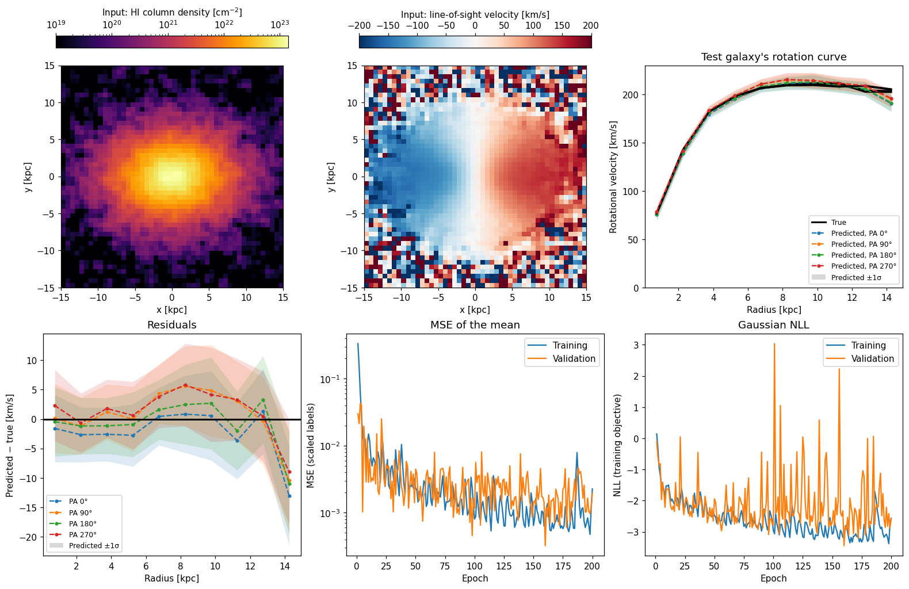

# CoNNGaFit

[](https://github.com/ctrapped/CoNNGaFit/actions/workflows/tests.yml)

**Co**nvolutional **N**eural **N**etworks for **Ga**laxy **Fit**ting: train 3-d convolutional neural networks to predict the physical properties of a galaxy's gas, such as its radial momentum or rotation, directly from HI 21cm spectral datacubes.

Training data comes from [VeryObservableFIRE](https://github.com/ctrapped/VeryObservableFIRE) (VOF), which turns FIRE galaxy simulations into synthetic telescope observations paired with the true gas properties at every pixel.

## Highlights

- **Network:** a 3-d residual U-Net (`unet3d_resblock.py`) that reads a whole spectral datacube and predicts a map (one value per pixel) or a radial curve. Three output heads are available: two fully convolutional heads for large images, and a fully connected head for small images and radial curves.
- **Targets:** mass, radial / cylindrical-radial / rotational velocity, and radial / cylindrical-radial / rotational momentum (mass × velocity), all read from VOF's per-pixel annotations.
- **Configuration:** hyperparameters and datasets live in two TOML files, so a training run is reproducible from its config, and every trained model stores both files alongside its weights.
- **Development:** 360 automated tests on synthetic data, including end-to-end training runs; continuous integration (GitHub Actions) runs them on Python 3.11 and 3.12, plus [ruff](https://docs.astral.sh/ruff/) linting and formatting.

## Installation

Requires Python 3.11+. From the repository root:

```bash
pip install -e .            # CoNNGaFit and its dependencies
pip install -e ".[dev]"     # + development tools (pytest, ruff, pre-commit)
```

To train on a GPU, install a CUDA-enabled build of PyTorch first (see [pytorch.org](https://pytorch.org/get-started/locally/)). Instructions for the Quartz cluster at IU are in [`Tutorials/Quartz`](Tutorials/Quartz/README.md).

## Demo

```bash
python examples/demo.py
```

Trains a small network on VOF observations of six synthetic disk galaxies, each rotating at a different speed ([`examples/demo_data`](examples/demo_data), ~10 MB), then predicts the rotation curve of a galaxy it hasn't seen, along with 1σ uncertainty. It needs no simulation data, takes a few minutes on a laptop CPU, and writes `examples/demo_output/demo.png`:



To run a trained network on new datacubes without training, run

```bash
python examples/demo_inference.py
```

which runs the pre-trained demo network in [`examples/demo_model`](examples/demo_model) on the test galaxy in a few seconds, writing a plot and an `.hdf5` file of each predicted rotation curve and its 1σ uncertainty to `examples/demo_output/inference/`. Pass `--model-path examples/demo_output/NetworkWeights/demo` to use the network you trained with `demo.py` instead.

[`examples/make_demo_data.py`](examples/make_demo_data.py) regenerates the data with VOF.

## Training

```bash
python train_model_unet.py --run-name my_run
```

Training is set by two parameter files, `configs/hyperparams.toml` and `configs/datasets.toml` by default; pass others with `--hyperparams` and `--datasets`. Every key is required unless marked optional.

### Datasets file

`configs/datasets.toml` sets what to learn and which VOF outputs to learn it from:

```toml
target = "radial_momentum"      # mass, radial_velocity, cylindrical_radial_velocity, rotational_velocity,
                                # radial_momentum, cylindrical_radial_momentum, rotational_momentum
augment = "major_axis"          # rotations/flips added to the training set: "major_axis", "all" or "none"
inclinations = [45]             # inclinations to use in every set: "all", or a list in degrees
radial_bins = 0                 # 0 trains on maps; N > 0 trains on N-bin radial curves
radial_projection = "face_on"   # where radial curves are measured: "face_on" or "sky"
suffix = ""                     # optional: VOF's outputSuffix in the filenames
base_dir = "/path/to/VOF_outputs"  # optional: relative paths below are relative to this

[training]
"m12i/vof_outputs" = [500, 600]   # a VOF output directory = a snapshot, or an inclusive [min, max] range
"m12f/vof_outputs" = 600

[validation]
"m12c/vof_outputs" = 600

[testing]
"m12m/vof_outputs" = 600
```

Each path is a VOF output directory, containing one folder per inclination (`i45/`, ...). CoNNGaFit loads every `*_fullSpectra.hdf5` image in it that matches the inclinations, snapshots and suffix.

### Hyperparameters file

| Key | Meaning |
|---|---|
| `learning_rate`, `weight_decay`, `epochs` | Adam optimizer settings and training length |
| `n_filt0`, `k0`, `k1` | Filters in the first encoder stage (doubling at each later stage), stem kernel size, residual/deconv block kernel size |
| `output_head` | `"conv_halfres"`, `"conv"` or `"fc"` (see the comments in the file) |
| `n_fc` | Width of the fully connected head's hidden layers (`output_head = "fc"` only) |
| `dropout_rate`, `block_dropout_rate` | Dropout before the output layer, and channel-wise dropout inside every block (off by default) |
| `label_scaling` | `"none"`, `"symmetric"` (divide by max \|label\|) or `"one-sided"` (map [min, max] to [-1, 1]) |
| `predict_variance` | `true` also predicts each value's 1σ uncertainty: the network outputs a mean and log-variance and trains with `nn.GaussianNLLLoss` instead of MSE. Needs `label_scaling = "symmetric"` or `"one-sided"` |
| `mass_weight_power` | Weights each pixel's (or ring's) loss by mass to this power, normalized per image (0: unweighted; 0.5 in `hyperparams_rc.toml`). Meant for velocity targets; pixels with no mass aren't trained, so their predictions and 1σ aren't meaningful |
| `seed` | Random seed for weight initialization, dropout and batch order; the same seed, data and settings on the same machine give the same network |

`configs/hyperparams_rc.toml` is a starting point for rotational velocity.

### Command-line options

| Option | Default | Purpose |
|---|---|---|
| `--run-name` | the target | Name of the checkpoint and every diagnostic output |
| `--network-dir` | `NetworkWeights` | Where the trained model is written |
| `--output-dir` | `DiagnosticOutputs` | Where diagnostic images and plots are written |
| `--batch-size` | ~1/10 of the training set (at least 2) | Training batch size; `0` trains on the full set as one batch |
| `--test-batch-size` | ~1/10 of the validation set | Validation/testing batch size |
| `-v` / `-q` | | Show debug messages / only warnings and errors |

Both output directories are created if missing. Run with `--help` for details.

### Outputs

```
NetworkWeights/
  <run-name>.pt       trained weights
  <run-name>.hdf5     everything needed to rebuild and use the network: image normalization
                      (image_stats), label scaling (label_stats), input_shape, output_head,
                      predict_variance, and the full text of both parameter files
DiagnosticOutputs/
  images/             final-epoch prediction vs. truth for every training, validation and
                      test sample (.hdf5, plus a comparison .png for validation and test);
                      with predict_variance, each prediction's 1σ as "uncertainty", and a
                      1σ panel in the comparison .png
  diagnostics/        loss (the training objective) and accuracy curves, prediction/truth
                      correlation plots, and <run-name>_LossesAndAccuracies.hdf5, which also
                      holds the MSE of the predicted mean
```

Predictions, labels and uncertainties in every saved output are in physical units (Msun, km/s or Msun km/s).

## Networks

| Module | Description |
|---|---|
| `unet3d_resblock.py` | The residual U-Net used by `train_model_unet.py` |
| `unet3d_dilated_resnet.py` | A dilated residual network with no downsampling, with the same interface |
| `unet3d_ddpm.py` | A conditional diffusion model that samples maps |
| `unet_blocks.py`, `unet_diagnostics.py` | Shared building blocks, and helpers for parameter counts and latent images |

Every network has a `summary()` method that prints its stages, shapes and parameter counts. [`examples/model_summaries.ipynb`](examples/model_summaries.ipynb) builds each one and checks its summary against a real forward pass.

## Observed data and inference

`fits_to_conngafit.py` converts an observed FITS datacube into CoNNGaFit's `.hdf5` input format, binning it down to the network's spatial size and trimming or padding its spectral axis. `fits_to_conngafit_template.py` shows example usage for four THINGS galaxies.

`use_model.py`, `inference_template.py` and `inference_test_validation_set.py` run a trained network on new datacubes. Networks trained with `predict_variance` also return (`use_model.predict(..., return_std=True)`) and save each prediction's 1σ.

## Development

```bash
pip install -e ".[dev]"
pre-commit install   # run ruff on every commit
pytest               # run every test (about 4 minutes)
pytest -m "not slow" # skip the demo-accuracy tests (about 2 minutes)
pytest tests/unit    # only the unit tests (a few seconds)
```

`tests/unit/` are simple unit tests. `tests/integration/test_pipeline.py` smoke tests each network. `tests/integration/test_demo.py` (marked `slow`; CI runs it on pull requests) trains the demo on all its data and checks the losses fall, the rotation curve is predicted accurately, and its predicted uncertainties are calibrated, for the newly trained and committed networks.

`main` is protected: changes go through pull requests, and the tests (`.github/workflows/tests.yml`) must pass first. Work on a branch and add tests in `tests/unit/` or `tests/integration/` for new code.

## Citation and license

If you use CoNNGaFit in your research, please cite it using [`CITATION.cff`](CITATION.cff) (GitHub's "Cite this repository" button). CoNNGaFit is released under the [MIT License](LICENSE).
